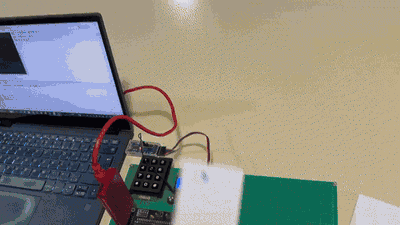
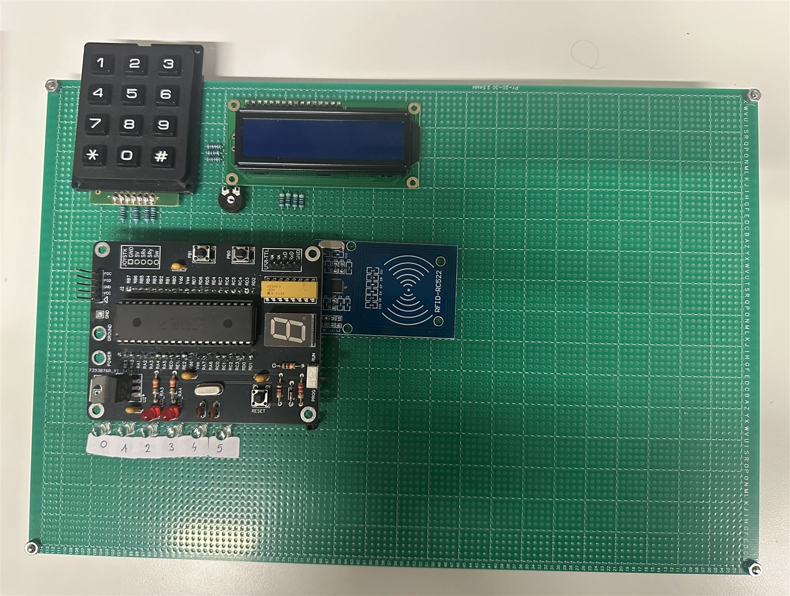
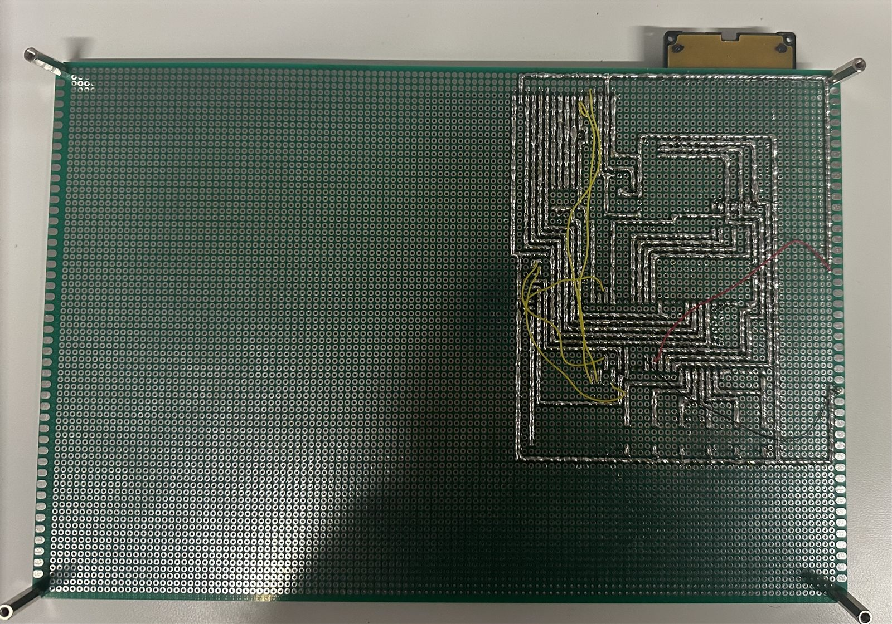

# LSSmartLight: RFID Lighting Controller

A programmable lighting controller for a meeting room, built for the *Digital Systems and Microprocessors*
course (La Salle, 2024–25). A user taps an RFID card on entry, and six lights fade to that user's saved
brightness levels. Tapping again turns everything off. Each user can change their preferences from a keypad,
and a serial menu on a PC shows the system state.

## Demo

A card is tapped on the reader, the lights fade to that user's saved levels, and the LCD and the serial
menu on the PC update to match.

## Features

- **RFID check-in and check-out:** an MFRC522 (RC522) module is driven over **bit-banged SPI**, since the
  PIC's hardware SPI was not allowed.
  - If the room is empty, a card loads that user's light profile.
  - If the same card is tapped again, the user leaves and all lights turn off.
  - If a different card is tapped, it takes over the room and loads its own profile.
  - Up to **8 users** are stored. Unknown cards are reported over serial and otherwise ignored.
- **Six dimmable lights:** each LED is driven by software PWM at 50 Hz with 11 intensity levels
  (`0`–`9`, plus `A` for full).
- **3×4 keypad:**
  - Press `<light><level>` to set a light, for example `3` then `7` puts light 3 at 70%. Use `*` for full brightness.
  - Changes are saved to the current user's profile.
  - A short press of `#` opens the serial menu. Holding `#` for 3 s clears every user's settings.
- **16×2 LCD:** shows the current user, a clock and all six light levels, for example
  `F 16:30 1-0 2-3 3-3 4-0 5-9 6-A`.
- **Serial menu** (UART at 115200 baud, opened with `Esc`):
  1. Who is in the room?
  2. Show settings for all registered users
  3. Set the system time

## Architecture

The firmware is written in C and uses a **cooperative multitasking** design. Each module is an abstract data
type (TAD) with a non-blocking state machine, its "motor". `main()` calls every motor in turn
inside an endless loop. A single TMR0 interrupt every 2 ms drives a set of virtual software timers that
all modules share.

| Module | Responsibility |
|--------|----------------|
| `main.c` | Init and the cooperative main loop |
| `TAD_TIMER` | TMR0 interrupt and virtual timers |
| `TRFID` | MFRC522 driver over software SPI, the UID whitelist and per-user light profiles |
| `TAD_KEYPAD` | Keypad scanning, debouncing, and short/long press detection |
| `TAD_LED1`–`TAD_LED6` | One software-PWM generator for each light |
| `TAD_Menu` | Serial menu and command handling |
| `TAD_SIO` | UART driver |
| `TAD_Time` | Real-time clock (HH:MM) |
| `LcTLCD` | Non-blocking HD44780 LCD driver |

### Hardware

- PIC18F4321 with a 10 MHz crystal and HSPLL, giving a 40 MHz clock
- RFID-RC522 module: `RC0` is MISO, `RC1` MOSI, `RC2` SCK, `RC3` CS and `RC4` RST
- Six lights on `RA0`–`RA5`
- 3×4 matrix keypad and a 16×2 character LCD
- USB-TTL serial link to a PC on `RC6`/`RC7`

## Building

1. Open `firmware/Setup_P2.X` in **MPLAB X** with the **XC8** compiler installed.
2. Build and program a PIC18F4321 with a PICkit.

You can also flash the prebuilt `firmware/lssmartlight.hex` directly.

The accepted card UIDs and their default light levels are hard-coded in `TRFID.c`
(`acceptedUIDs` / `userLEDs`). Replace them with your own cards' UIDs.

## Photos

| Top | Bottom |
|-----|--------|
|  |  |

## Authors

Teodor Arsovski and Mateja Džunić
